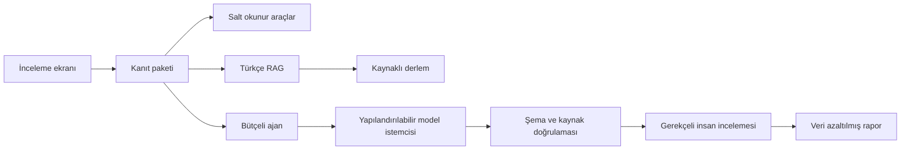

# İadePusula

### Türkçe e-ticaret başvuruları için kaynaklı ön inceleme

İadePusula; sipariş bilgilerini, süre hesaplarını ve ilgili mevzuat kaynaklarını tek
çalışma alanında birleştirir. Müşteri temsilcisi başvuruyu inceler, kanıta bağlı
öneriyi değerlendirir ve gerekçeli bir inceleme kaydı oluşturur.

[](https://github.com/sektor-kampuste-git/iadepusula-kostu-230501013-230501017-230501016/actions/workflows/ci.yml)

[Hızlı başlangıç](#hızlı-başlangıç) · [Mimari](#mimari) · [Ölçüm](#ölçüm-ve-değerlendirme) · [Belgeler](#proje-yapısı-ve-belgeler)

**Sürüm 0.3.1 — geliştirme prototipi.** Uygulama sentetik siparişlerle yerelde
çalışır. Canlı demo ve tanıtım videosu yayın hazırlığındadır.

## Neyi çözüyor?

Bir iade başvurusunda sipariş, teslim tarihi, başvuru türü ve mevzuat koşullarının
birlikte incelenmesi gerekir. İadePusula bu bilgileri kaynaklarıyla yan yana
göstererek uzmanın inceleme yapmasını kolaylaştırır.

- **Kanıt paketi:** sipariş, takvim hesabı, parasal sınır ve ilgili kaynaklar.
- **Kaynaklı arama:** Türkçe BM25; isteğe bağlı gömme ve Qdrant ile hibrit arama.
- **Doğrulanmış taslak:** kaynak, alıntı, tutar ve insan incelemesi koşullarından geçen tipli çıktı.
- **Kontrollü iş akışı:** adım, süre ve USD sınırları; içerik taşımayan işlem izleri.
- **İnsan incelemesi:** kaynak okuma, gerekçeli değerlendirme ve veri azaltılmış rapor.

Ürün, ön inceleme desteği sunar. Kesin hukuki karar, ödeme veya tebligat işlemi yapmaz.

## Nasıl çalışır?

1. Sipariş numarası, başvuru tarihi ve açıklama girilir.
2. Yerel araçlar ve RAG ilgili bilgileri tek bir kanıt paketinde toplar.
3. Model modu seçilmişse bütçe denetimli bir taslak üretilip doğrulanır.
4. Uzman kaynakları inceler; öneriyi gerekçesiyle onaylar veya değiştirir.
5. İnceleme kaydından sonra serbest metinleri içermeyen rapor indirilebilir.

Taslak ve onay başvuru metnine, tarihine ve kanıtlarına bağlıdır.
Başvuru değiştiğinde önceki inceleme yeni başvuru için kullanılamaz.

## Hızlı başlangıç

**Gereksinim:** Python 3.11+. Depoyu klonlayın veya **Code → Download ZIP** ile
indirip açın. Proje kökünde Windows PowerShell komutları:

```powershell
python -m venv .venv
.venv\Scripts\python.exe -m pip install -r requirements-ui.txt
.venv\Scripts\python.exe -m streamlit run app.py --server.address 127.0.0.1
```

Terminaldeki yerel adresi açın. İlk deneme:

- **Sipariş:** `SIP-2026-1002`
- **Başvuru tarihi:** `2026-10-31`
- **Açıklama:** “Kulaklık bozuk, ayıplı mal nedeniyle iade istiyorum.”

Bu sabit geliştirme senaryosunda **Yerel kanıt** veya **Ağsız ajan demosu** seçilebilir.
Her iki yol da API anahtarı olmadan çalışır.
macOS/Linux'ta Python yolu `.venv/bin/python` olur.

### Çalışma biçimleri

| Mod | İşleyiş | API anahtarı |
| --- | --- | --- |
| Yerel kanıt | Yerel sipariş, hesaplar ve kaynak araması | Gerekmez |
| Ağsız ajan demosu | Gerçek iş akışı; model yanıtı ve token sayıları taklit | Gerekmez |
| Gerçek model | Açık onay, sağlayıcı ve tarihli tarife ile model çağrısı | Gerekir |

Gerçek model ayarları [.env.example](.env.example) üzerinden sunucu ortamına
tanımlanır: `LLM_BASE_URL`, `LLM_API_KEY`, `LLM_MODEL`, `PRICE_*` ve `AGENT_*`.
Anahtarlar repoya veya arayüze yazılmaz. İstemci sağlayıcıdan bağımsız tasarlanmıştır;
iki gerçek sağlayıcı doğrulaması geliştirme planındadır.
[Ayrıntılı kurulum ve doğrulama](docs/kurulum_ve_dogrulama.md).

## Mimari



**Teknolojiler:** Python, Streamlit, Pydantic, HTTPX, BM25 ve isteğe bağlı Qdrant.
CLI ve MCP girişleri aynı yerel araçları kullanır.
Arayüz, iş kuralları ve model erişimi ayrı katmanlardır.
[Mimari ve veri sözleşmeleri](docs/mimari.md).

## Ölçüm ve değerlendirme

**Son kayıt: 1 Kasım 2026.** Sonuçlar ağsız geliştirme ortamına aittir.

| Kontrol | Sonuç | Ölçülen kapsam |
| --- | --- | --- |
| Otomatik test | 321 geçti | Şema, araç, istemci, bütçe, UI ve entegrasyon |
| Bileşen eval | 30/30 | Sentetik geliştirme vakaları; 6'sı adversarial |
| Kaynak hit@3 | 20/20 | Kaynak beklenen vakalarda ilk üç sonuç |
| CI | Python 3.11 / 3.12 / 3.14 | Kod, belge, sır, test, eval ve paket kontrolü |

Eval hakemi otomatik beklenti kontrolüdür; etiketler AI taslağıdır.
Bu sonuçlar bağımsız insan değerlendirmesi veya gerçek model karar doğruluğu değildir.
[Ham kanıt](docs/kanitlar/2026-11-01_entegrasyon.json) ·
[Eval yöntemi](eval/README.md) · [Doğrulama kaydı](docs/gelistirme_kaydi_2026-11-01.md).

## Maliyet

Hesaplayıcı; token kullanımı ve açık tarifeden istek/aylık tahmin üretir.
Aşağıdaki değerler **fiyat varsayımıyla simülasyondur**:
2.100 girdi + 450 çıktı token; 1M token başına sırasıyla 1 ve 2 USD.

| Senaryo | Model API maliyeti |
| --- | --- |
| Bir istek | 0.003 USD |
| 1.000 kullanıcı × ayda 10 istek | 30 USD/ay |

Barındırma, gömme ve işletim giderleri dahil değildir; gerçek sağlayıcı ölçümü
henüz yoktur. Çağrı öncesi rezervasyon, çıktı sınırı ve kamusal derlem gömme
önbelleği bulunur. Model kademesi ve önbelleğin gerçek kalite/maliyet etkisi
ölçülecektir. [Hesaplama komutu ve sınırlar](docs/kurulum_ve_dogrulama.md#maliyet).

## Güvenlik ve yönetişim

- Yalnız sentetik siparişler kullanılır; gerçek kişi verisi girilmemelidir.
- Kaynak kimliği, URL, madde, birebir alıntı ve tutar doğrulanır.
- Modelin izinleri salt okunur iş akışıyla sınırlıdır; adım/süre/USD bütçesi uygulanır.
- Taslak insan incelemesi gerektirir; demo onayı kimlik doğrulama yerine geçmez.
- Ham başvuru/model metni işlem izlerine ve indirilen rapora eklenmez.

Gerçek RBAC, sipariş sahipliği, kalıcı denetim ve saklama politikası geliştirme
kapsamındadır. Maskeleme tüm kişisel veriyi garanti etmez. EU AI Act risk/takvim
ve KVKK hukuki değerlendirmesi resmi kaynaklarla tamamlanacaktır.
[Kullanım senaryosu](docs/kullanim_senaryosu.md) · [Model kartı](docs/model_karti.md).

## Proje yapısı ve belgeler

```text
app.py             İnceleme ekranı
src/               RAG, araçlar, model istemcisi, ajan ve insan incelemesi
data/              Sentetik siparişler ve kaynaklı mevzuat pasajları
eval/              Vakalar, koşucu ve kalibrasyon aracı
tests/             Ağsız testler
scripts/           Demo ve doğrulama komutları
docs/              Tasarım, kullanım, ekip ve kanıt belgeleri
.github/           CI ve PR düzeni
SPEC.md            Ürün kapsamı ve kabul koşulları
TESLIM.md          Teslim durumu ve sorumluluk kanıtları
```

[Belge dizini](docs/README.md) · [Kaynak kod rehberi](src/README.md) ·
[Veri kaynakları](data/README.md) · [Test rehberi](tests/README.md) ·
[Ürün kapsamı](SPEC.md) · [Geliştirme ve teslim planı](docs/proje_isterleri.md).

## Ekip

**Şarjör** — Kocaeli Sağlık ve Teknoloji Üniversitesi, Bilgisayar Mühendisliği.

| Geliştirici | Öğrenci no | Sorumluluk alanı |
| --- | --- | --- |
| Emre Berk Güç | 230501013 | Derlem, RAG, deterministik araçlar, eval |
| Zeynep Zehra Kocatürk | 230501017 | Şema, istemci, ajan, güvenlik, maliyet, CI |
| Beste Tuana Çuhadar | 230501016 | Arayüz, insan incelemesi, yönetişim, sunum |

Katkı ve doğrulama kayıtları [TESLIM.md](TESLIM.md) ve commit/PR geçmişinde;
ekip düzeni [çalışma rehberinde](docs/ekip_calisma_rehberi.md) tutulur.

## AI kullanımı

Codex araştırma, kod, test ve dokümantasyon taslaklarında kullanıldı.
Önceki ücretsiz OpenCode incelemelerinin sonuçları kendi tarihli kayıtlarında yer alır.
Somut geliştirme hatası: aynı siparişte farklı başvuruya ait taslak onaylanabiliyordu.
Başvuru/tarih/kanıt bağı eklenerek düzeltildi ve regresyon testleriyle korundu.
AI çıktılarının ekip tarafından anlaşılması ve insan incelemesi ayrıca gereklidir.
[Hata, düzeltme ve kanıt](docs/gelistirme_kaydi_2026-11-01.md).

## Sınırlar ve yayın planı

Derlem 40 seçilmiş pasajdan oluşur; tam konsolide mevzuat değildir.
Gerçek iki sağlayıcı, insan kalibrasyonu, bağımsız eval, dış red-team, gerçek maliyet,
yük/soğuk başlangıç ölçümü, canlı URL ve video teslim planındadır.
Güncel durum [gereksinim listesinde](docs/proje_isterleri.md) açıkça izlenir.

## Lisans

Dağıtım lisansı ekip kararı aşamasındadır; henüz LICENSE dosyası bulunmuyor.
Üçüncü taraf kod ve veri koşulları lisans seçimiyle birlikte belgelenecektir.
