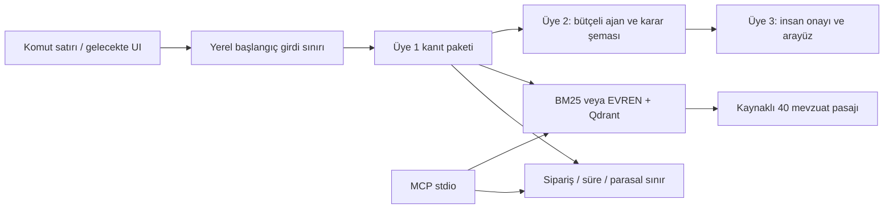

# İadePusula

[](https://github.com/sektor-kampuste-git/iadepusula-kostu-230501013-230501017-230501016/actions/workflows/ci.yml)

Türkçe e-ticaret iade ve ayıplı mal başvuruları için **kaynaklı insan incelemesi**
projesi. Sürüm **0.2.0**, Üye 1'in RAG, deterministik araç ve eval temelidir.
Kanıt paketi üretir; nihai hukuki karar veya ödeme işlemi uygulamaz.

## Çalışan özellikler

- 100 sentetik sipariş, 40 kaynak/madde bilgili mevzuat pasajı.
- Ağsız Türkçe BM25 araması ve isteğe bağlı EVREN gömme + Qdrant hibrit arama.
- Salt okunur sipariş, 14 takvim günü ve başvuru yılına göre parasal sınır araçları.
- Kaynak URL'si, madde, birebir alıntı ve getirilen parça kimliği doğrulaması.
- Belge/fıkra/bent ayrımı, kaynak türü ve PDF sayfası; atıfta yasal koşulun korunması.
- Kamusal derlem gömmeleri için 24 saatlik JSON önbelleği; sorgular diske yazılmaz.
- En fazla dört bileşen çağrısıyla insan inceleme paketi ve araç izleri.
- Dört araçlı MCP stdio sunucusu, komut satırı arayüzü.
- 30 vakalık geliştirme eval'i, ağsız testler ve CI.

## Kurulum

Python 3.11+ gerekir. Windows PowerShell:

```powershell
git clone https://github.com/sektor-kampuste-git/iadepusula-kostu-230501013-230501017-230501016.git
cd iadepusula-kostu-230501013-230501017-230501016
git switch develop
python -m venv .venv
.venv\Scripts\python.exe -m pip install -r requirements-dev.txt
```

macOS/Linux'ta `.venv\Scripts\python.exe` yerine `.venv/bin/python` kullanılır.
Komutlar depo kökünde çalıştırılır. Anahtar olmadan:

```powershell
.venv\Scripts\python.exe -m src.cli inspect SIP-2026-1002 "Kulaklık bozuk, ayıplı mal nedeniyle iade istiyorum" --date 2026-10-31
.venv\Scripts\python.exe -m src.cli search "14 günlük cayma hakkı"
.venv\Scripts\python.exe -m src.cli deadline 2026-10-01 2026-10-15
.venv\Scripts\python.exe -m src.cli threshold 186000.00 2026
.venv\Scripts\python.exe -m pytest -q
.venv\Scripts\python.exe -m eval.eval_kosucu
```

Eval çıktısı `artifacts/eval.json` içindedir. Hedef 14. gün dahil, TL tutarında
kuruş duyarlılığı, tam parasal sınırın dışında kalması, bilinmeyen sipariş/yıl,
eksik bilgilendirme, sahte madde ve ayıplı mal/cayma ayrımıdır.

## Üye 3 yerel arayüz başlangıcı

Sipariş, hesaplamalar, uyarılar ve kaynaklar Streamlit ekranında incelenebilir:

```powershell
.venv\Scripts\python.exe -m pip install -r requirements-ui.txt
.venv\Scripts\python.exe -m streamlit run app.py --server.address 127.0.0.1
```

Bu ekran yalnız yerel BM25 ve sentetik siparişleri kullanır; API çağrısı yapmaz.
Karar ajanı, kalıcı insan onayı ve denetim kaydı henüz tamamlanmadı.
[Kapsam, kullanım ve AI yardımı kaydı](docs/uye3_arayuz.md).
Arayüz testleri geliştirme bağımlılıklarına dahildir.

## EVREN bağlantısı

```powershell
Copy-Item .env.example .env
# .env içindeki LLM_API_KEY alanını yerel olarak doldurun.
.venv\Scripts\python.exe -m src.cli models
.venv\Scripts\python.exe -m src.cli search "14 günlük cayma hakkı" --backend evren
.venv\Scripts\python.exe -m scripts.smoke_evren
```

Mevcut yerel `.env` varsa ilk komutla üzerine yazmayın. Anahtar Git'e girmez ve
komut çıktısında yazdırılmaz. `LLM_BASE_URL`, `LLM_API_KEY`, `LLM_MODEL` ve
`EMBEDDING_MODEL` ortam ayarlarıdır; EVREN adresi
`https://evren-llmapi.ssyz.org.tr/v1` olarak doğrulanmıştır.

EVREN yolu gerçek API kotası kullanır. İlk arama derlemi gömer; sonraki
aramalarda aynı model ve derlem için disk önbelleği de yeniden kullanılır.
Önbellek eski/bozuksa yenilenir; kaynak/model değişikliği yeni anahtar oluşturur.
Sorgu gömmesi her aramada API'ye gider. Smoke testi yalnız
sentetik senaryo ile birebir alıntı seçen JSON üretir ve alıntıları doğrular. Hukuki
yorum veya tam ajan başarısı bu testle ölçülmez. Gerçek başvurularda isim/adres
dahil tam güvenlik katmanı tamamlanana kadar sağlayıcıya yalnız sentetik metin gönderin.

## Mimari



Üye 2 ve Üye 3 kutuları entegrasyon planıdır; bu sürümde tamamlanmış değildir.

## Ölçüm ve sınırlar

31 Ekim 2026 tarihli yerel bileşen eval'inde 30/30 vaka ve kaynak beklentili 20
vakada hit@3 20/20 elde edildi. İlk koşum 27/30 idi; maskeleme alanlarının
aramadan çıkarılması ve Türkçe sorgu genişletmesiyle üç sıralama hatası düzeltildi.
**Aynı set geliştirmede kullanıldı; bağımsız test, insan kalibrasyonu veya nihai
ajan karar doğruluğu değildir.** Tüm etiketler AI taslağıdır.

Resmî kaynaklardan seçilmiş pasajlar tam konsolide mevzuat değildir ve hukuk
uzmanı onayı bekler. Genel prompt injection savunması, gerçek RBAC, nihai karar
doğrulayıcıları, USD bütçeli ajan, onay arayüzü ve canlı yayınlama sonraki takım
entegrasyonudur. İsim/adres maskeleme mevcut desenlerle garanti edilmez.

- [Entegrasyon sözleşmesi ve MCP kurulumu](docs/uye1_entegrasyon.md)
- [Geliştirme planı](docs/gelistirme_plani.md)
- [Derlem kaynakları ve sürüm sınırları](data/mevzuat_derlemi/README.md)
- [Eval ve gerçek insan kalibrasyonu](eval/README.md)
- [Red team başlangıç kontrolleri](eval/redteam.md)
- [Tarihli doğrulama kaydı](docs/dogrulama_2026-10-31.md)
- [v0.2 denetimi ve düzeltilen sorunlar](docs/denetim_v0.2.md)

## Normal paket kurulumu

Depo kökünde çalışmaya ek olarak sipariş, mevzuat ve varsayılan eval verileri
wheel paketine dahildir. Kaynak klasörüne bağımlılık olmadan da kullanılabilir:

```powershell
.venv\Scripts\python.exe -m pip install .
.venv\Scripts\iadepusula.exe search "MSY Madde 15/1-ç"
```

Kurulu pakette yerel `.env` ve `artifacts/` için komutun çalıştırıldığı dizin
kullanılır. Kaynak depo dışındaki paket doğrulaması CI içinde de yürütülür.

## Geliştirme düzeni

- `main`: doğrulanmış, paylaşılabilir sürüm.
- `develop`: sürekli geliştirme ve ekip entegrasyonu.
- Özellikler `develop` üzerinden geliştirilir; testlerden sonra `main`e alınır.
- API anahtarı `.env` içinde tutulur; kaynak PDF ve anahtar dosyası Git'e eklenmez.

## İş bölümü

| Üye | Sorumluluk |
| --- | --- |
| 1 | Ürün kapsamı, mevzuat derlemi, RAG, deterministik araçlar, 30 vaka ve eval koşucusu |
| 2 | Ajan, sağlayıcı istemcisi, karar şemaları, güvenlik, maliyet ve CI |
| 3 | Streamlit arayüzü, insan onayı, yönetişim, red team ve sunum |

Bu ilk kurulum Üye 1 kapsamını temel alır. Proje dokümanındaki örnek skorlar,
kalibrasyon sonuçları, canlı demo adresleri ve tamamlanmış teslim iddiaları ölçüm
veya gerçek teslim kanıtı olarak kullanılmaz.

## Yapay zeka kullanımı

Geliştirmede Codex; kaynak araştırma, uygulama, test, dokümantasyon ve doğrulama
için kullanıldı. Ücretsiz OpenCode DeepSeek ile ilk doküman incelemesi zaman
aşımına uğradı; ikinci dar kod incelemesi tamamlandı ve bulgular ana ajan
tarafından kontrol edildi. İnceleme para/tarih doğrulamaları ve eksik bilgiyle
son gün gösterme davranışını iyileştirdi. Testlerin yakaladığı gerçek hata,
Türkçe `I/ı` dönüşümünün `API`/`Ignore` saldırı kalıplarını kaçırmasıydı;
normalleştirme düzeltildi ve regresyon testleri eklendi. Üretilen çalışma,
ekibin insan incelemesinin yerini tutmaz.


## Üye 3 — İnceleme ekranı ve insan değerlendirmesi

Yerel Streamlit ekranı `app.py` ile çalışır. Kurulum için [üye 3 rehberi](docs/uye3_arayuz.md).
Sipariş, hesaplar ve kaynaklar gösterilir; gerekçeli insan değerlendirmesinden sonra
serbest metinsiz JSON özeti indirilir. Başarısız yeni istek eski onayı temizler.
Bu onay kimliği doğrulanmamış sentetik demo kaydıdır; gerçek kabul/ret kararı değildir.
Üye 2 ajanı henüz entegre değildir. Canlı URL, video ve model maliyeti henüz yoktur.

- [Kullanım senaryosu](docs/kullanim_senaryosu.md)
- [Sistem kartı](docs/model_karti.md)
- [Doğrulama](docs/uye3_dogrulama.md)
- [Red team deneme rehberi](docs/uye3_redteam.md)
- [Demo planı](docs/demo_metni.md)
- [Teslim taslağı](TESLIM.md)

Üye 3 ekranı, insan inceleme modülü, test ve belge taslakları Codex yardımıyla hazırlandı.
Tasarım düzeltmesi: başarısız yeni değerlendirmede önceki onayın rapor indirmeye izin
vermemesi sağlandı ve regresyon testi eklendi. Bu geliştirme kararı üretim hatası geçmişi
veya kullanıcının kendi bulduğu hata olarak sunulmamalıdır.
