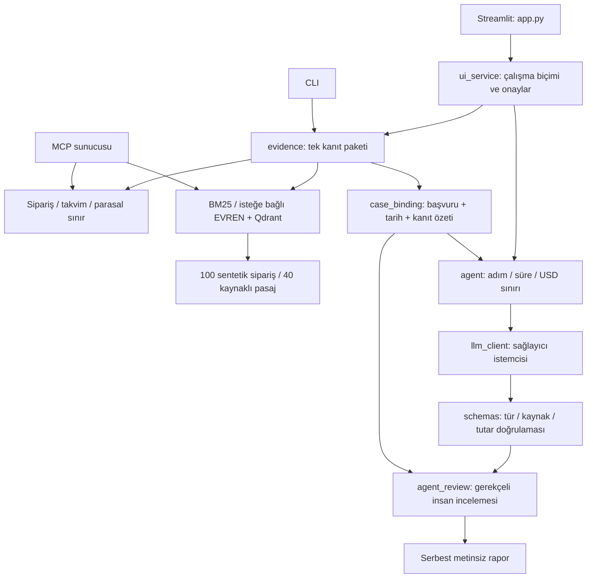

# İadePusula

[](https://github.com/sektor-kampuste-git/iadepusula-kostu-230501013-230501017-230501016/actions/workflows/ci.yml)

**Türkçe e-ticaret iade başvurularını kaynaklarıyla inceleyen uzman çalışma alanı.**
Sipariş bilgisi, süre hesabı ve ilgili mevzuat aynı ekranda toplanır. İsteğe bağlı
model bu kanıtlara bağlı bir ön inceleme taslağı önerir. İnsan kaynakları okuyup
gerekçeli değerlendirme yapar; uygulama ödeme, tebligat veya kesin hukuki karar üretmez.

**0.3.1 · Sentetik verili geliştirme prototipi · 1 Kasım 2026**

Takım **Şarjör** — Kocaeli Sağlık ve Teknoloji Üniversitesi, Bilgisayar Mühendisliği.

## Demo ve video

Canlı URL ve video henüz hazırlanmadı. Yerel ekran aşağıdaki komutlarla anahtarsız
çalışır. Nihai hedef giriş gerektirmeyen sentetik demo ve **en fazla 2 dakikalık video**;
ders sunumu ayrıca 3 dakikadır. Bunlar tamamlanmış teslim kanıtı değildir.

## Problem ve kullanım

Hedef kullanıcı başvuruyu ön inceleyen müşteri temsilcisi/uzmandır.
İadePusula, farklı yerlerde bulunan sipariş, tarih ve kaynak koşullarını izlenebilir
bir kanıt paketinde birleştirir. Üç çalışma biçimi vardır:

- **Yerel kanıt:** varsayılan; BM25 araması ve yerel araçlar çalışır, model çağrılmaz.
- **Ağsız ajan demosu:** gerçek iş akışı; model yanıtı ve token sayıları kontrollü taklit.
- **Gerçek model:** açık sentetik veri/API onayı ve sunucuda anahtar, model,
  bütçe ve tarife gerekir. İki gerçek sağlayıcı doğrulaması henüz tamamlanmadı.

Başarılı taslak insan incelemesi gerektirir. Demo onayı kimliği doğrulanmış
kurumsal yetki veya gerçek iade işlemi değildir.

## Kurulum ve çalıştırma

Python **3.11+** gerekir. Git ile klonlayın veya **Code → Download ZIP** ile indirip
açın. Komutları proje kökünde çalıştırın. Geliştirme dalı `develop`, doğrulanmış dal
`main`dir. İlk kurulum bağlantıya bağlıdır; 5 dakikalık kurulum süresi henüz ölçülmedi.

```powershell
python -m venv .venv
.venv\Scripts\python.exe -m pip install -r requirements-dev.txt
.venv\Scripts\python.exe -m streamlit run app.py --server.address 127.0.0.1
```

Terminalin gösterdiği yerel adresi açın. **SIP-2026-1002**, **2026-10-31**,
“**Kulaklık bozuk, ayıplı mal nedeniyle iade istiyorum.**” ile başlayın.
Yerel kanıtı veya ağsız ajan demosunu seçin. Kaynakları okuyup gerekçe girin;
geçerli değerlendirmeden sonra veri azaltılmış JSON raporu indirilebilir.
Tarih sabit test senaryosudur; gelişigüzel bugünün tarihiyle değiştirmeyin.

macOS/Linux'ta `.venv\Scripts\python.exe` yerine `.venv/bin/python` kullanılır.

### Ağsız doğrulama

```powershell
.venv\Scripts\python.exe -m pytest -q
.venv\Scripts\python.exe -m eval.eval_kosucu --min-pass-rate 0.85 --output artifacts/eval.json
.venv\Scripts\python.exe -m scripts.demo_uye2 --output artifacts/uye2-demo.json
.venv\Scripts\python.exe -m scripts.check_docs --output artifacts/docs.json
.venv\Scripts\python.exe scripts/check_secrets.py
.venv\Scripts\python.exe -m ruff check app.py src eval scripts tests maliyet_hesapla.py
.venv\Scripts\python.exe -m ruff format --check app.py src eval scripts tests maliyet_hesapla.py
```

CI aynı kontrolleri Python 3.11, 3.12 ve 3.14 üzerinde çalıştırır; wheel paketini
de depo dışında doğrular. Yeşil rozet hukuki doğruluk veya insan onayı değildir.

### Ortam değişkenleri ve sağlayıcılar

Ağsız yolda `.env` gerekmez. Gerçek model için [.env.example](.env.example)
alanlarını yerel `.env` veya barındırıcı sır ayarlarına aktarın; mevcut dosyayı ezmeyin.
`LLM_BASE_URL`, `LLM_API_KEY`, `LLM_MODEL` istemciyi belirler.
`AGENT_*` sınırlar; `PRICE_*` tarihli ve kaynaklı tarifedir.
Tarife yoksa model çağrısından önce durulur. Test tarifesi gerçek ağ istemcisinde reddedilir.

Örnek EVREN ayarı iki sağlayıcıda başarı kanıtı değildir. Diğer OpenAI uyumlu uçlarda
aynı ortam sözleşmesi kullanılır; JSON desteği ve özellikler ayrıca sınanmalıdır.
Gerçek API çağrısı kota tüketebilir. [İstemci ve bütçe ayrıntıları](docs/uye2_entegrasyon.md).

## Mimari



Arayüz model istemcisini doğrudan çağırmaz. Üye 1'in kanıtı, Üye 2'nin taslağı ve
Üye 3'ün incelemesi **aynı başvuru özetiyle** bağlanır. Metin, tarih veya kaynak
değişirse eski taslak/onay kullanılamaz. Ölçüm süreleri kimlikten dışlanır.
SHA-256 özeti imza, yetkilendirme veya anonimleştirme değildir.
[Mimari ve veri sözleşmeleri](docs/mimari.md).

## Klasörler ve dosyalar

```text
app.py                  Streamlit giriş ekranı
src/                    İş kuralları, RAG, istemci, ajan ve inceleme
data/                   Sentetik siparişler ve kaynaklı mevzuat parçaları
eval/                   Geliştirme vakaları, koşucu ve kalibrasyon
tests/                  Ağsız birim ve entegrasyon testleri
scripts/                Demo, veri hazırlama ve depo kontrolleri
docs/                   Tasarım, ekip rehberi ve tarihli kanıtlar
.github/workflows/      Otomatik doğrulama
.streamlit/             Arayüz tema ayarları
SPEC.md                 Ürün kapsamı ve kabul koşulları
TESLIM.md               Teslim durumu ve sorumluluk kanıtları
.env.example            Ortam değişkeni sözleşmesi
maliyet_hesapla.py       Varsayımlı istek/aylık maliyet hesabı
```

[Kaynak kod](src/README.md), [veri](data/README.md), [test](tests/README.md),
[script](scripts/README.md) ve [belge rehberleri](docs/README.md) klasörlerin amacını açıklar.
[Dosyaları anlatma rehberi](docs/kodu_anlama_rehberi.md) tüm ekibin soru-cevap hazırlığı içindir.

## Eval ve ölçüm

31 Ekim 2026 kaydı: **30/30 geliştirme bileşen vakası**, kaynak beklenen
20 vakada **20/20 hit@3**. İlk koşum 27/30 idi; Türkçe sorgu genişletmesi ve
maskeleme alanlarının aramadan çıkarılması üç sıralama hatasını düzeltti.
Hakem otomatik bileşen beklentileridir; etiketler AI taslağıdır, insan onaylı değildir.
[Ham rapor](eval/sonuclar/2026-10-31_v0.2_bilesenler.json).

Güncel birleşik sürümün test/eval sayıları ve komutları
[1 Kasım geliştirme kaydındadır](docs/gelistirme_kaydi_2026-11-01.md).
Test, bileşen eval'i ve gerçek model karar başarısı ayrı ölçümlerdir.
Geliştirmede kullanılan set bağımsız test sayılamaz.

Tam puan hedefi: **30+** gerçek/anonim kökeni belgelenmiş vaka, en az 5 zorlayıcı
vaka, insan etiketleriyle hakem kalibrasyonu, en az 8 gerçek red-team denemesi
ve CI'da tarihli ajan eval'i. Mevcut 30 sentetik vaka bu şartların hepsini karşılamaz.
[Eval yöntemi](eval/README.md), [red-team planı](eval/redteam.md).

## Maliyet

```powershell
.venv\Scripts\python.exe -m maliyet_hesapla --input-tokens 2100 --output-tokens 450 --input-price 1 --output-price 2 --users 1000 --requests-per-user 10
```

**Simülasyon:** 1M girdi token için 1 USD ve çıktı için 2 USD varsayılır.
2.100 girdi + 450 çıktı = **0.003 USD/istek**; 1.000 kullanıcı × ayda 10 istek =
**30 USD/ay**. Gerçek fiyat/fatura veya ücretsiz kota ölçümü değildir.
Barındırma, gömme ve işletim giderleri dahil değildir.

Çağrı öncesi rezervasyon yapılır; bilinmeyen kullanım sıfır yazılmaz.
Rezervasyon sağlayıcının kesin harcama tavanı değildir. Kamusal derlem gömmelerinde
önbellek vardır. Taslak önbelleği, model kademesi ve çıktı uzunluğu optimizasyonunun
gerçek maliyet/kalite etkisi ölçülmedi. Sağlayıcı doğrulamasından sonra tarihli tablo eklenecek.

## Güvenlik ve yönetişim

- Yalnız sentetik sipariş ve kişisel bilgi içermeyen metin kullanılır.
  Maskeleme isim/adres dahil tüm kişisel veriyi garanti etmez.
- Anahtarlar sunucu ortamında kalır; ham başvuru/model metni izlere yazılmaz.
  İndirilen rapor serbest metinleri dışarıda bırakır.
- URL, madde, getirilen parça, birebir alıntı ve fatura sınırı doğrulanır.
- Model ödeme, bildirim veya keyfî araç yetkisi taşımaz. Giriş filtresi tek başına
  tam prompt injection savunması değildir.
- İnsan kaynak okuma beyanı ve gerekçe verir; değiştirilen öneri de doğrulanır.
  Demo kutucuğu kimlik doğrulama değildir.
- Gerçek RBAC, sipariş sahipliği, kalıcı denetim, saklama/silme politikası, oran
  sınırı ve yük testi olmadan gerçek veriye açılmaz.

EU AI Act sınıfı/takvimi ve KVKK hukuki uygunluğu bu sürümde doğrulanmadı.
Sınıf kullanım amacına ve güncel resmi kaynaklara göre gerekçelendirilecektir.
[Kullanım senaryosu](docs/kullanim_senaryosu.md), [model kartı](docs/model_karti.md).

## Ekip ve katkı

- **Emre Berk Güç — 230501013 / Üye 1:** derlem, RAG, deterministik araçlar, eval.
- **Zeynep Zehra Kocatürk — 230501017 / Üye 2:** şemalar, istemci, bütçeli ajan,
  güvenlik/maliyet, CI; başvuru bağlama ve ortak belge kontrolleri.
- **Beste Tuana Çuhadar — 230501016 / Üye 3:** arayüz, insan incelemesi,
  UI–ajan bağlantısı, yönetişim ve sunum hazırlığı.

Sahiplik tamamlanma iddiası değildir. Katkı commit/PR, test ve [TESLIM.md](TESLIM.md)
ile gösterilir. AI yardımlı kod ekip tarafından okunmalı ve açıklanabilmelidir.
[Birlikte geliştirme düzeni](docs/ekip_calisma_rehberi.md).

## AI kullanımı ve düzeltilen hatalar

Codex; araştırma, kod, test, inceleme ve belge taslaklarında kullanıldı.
Önceki ücretsiz OpenCode incelemesinin zaman aşımı başarı sayılmadı.
İnsan onayı verilmemiş kod “ekip inceledi” şeklinde gösterilmez.

Gerçek geliştirme hataları: Türkçe I/ı normalleştirmesi bazı saldırı kalıplarını
kaçırdı; düzeltildi. Zaman testi gerçek saate bağımlıydı; saat enjekte edildi.
UI'da başarısız yeni başvurunun eski raporu koruması engellendi.
Bu sürümde **kanıtın iki kez hazırlanması** ve **aynı siparişte başka başvuru
metnine ait taslağın onaylanabilmesi** başarısız testle gösterilip düzeltildi.
[Tekrar üretim ve kanıt](docs/gelistirme_kaydi_2026-11-01.md).
Bunlar gerçek müşteri olayları değildir. İnsan kod incelemesi otomatik testten ayrıdır.

## Sınırlar ve teslim durumu

Canlı URL, soğuk başlangıç, gerçek iki sağlayıcı, insan kalibrasyonu, bağımsız eval,
ekipler arası red team, gerçek maliyet, video ve teslim PDF'i henüz tamamlanmadı.
Derlem tam konsolide mevzuat değildir; güncellik/uzman kontrolü gerekir.
Çok kullanıcılı üretim kapasitesi ölçülmedi.

[Şartname](SPEC.md), [gereksinimler](docs/proje_isterleri.md),
[kanıt listesi](docs/proje_kriterleri.json) ve [teslim taslağı](TESLIM.md)
her PR'da birlikte güncellenir. Belge kontrolü gerçek uyum/not değerlendirmesi değildir.

## Lisans

Ekip dağıtım lisansı seçmedi; LICENSE henüz yok.
Herkese açık görünüm serbest kullanım izni anlamına gelmez. Üçüncü taraf kod/veri
koşulları, atıflar ve ekip lisansı teslimden önce kararlaştırılmalıdır.
